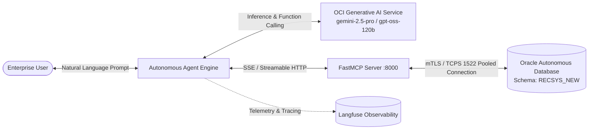

# Oracle Autonomous Database Agentic AI: Model Context Protocol (MCP) Server

> **Enterprise Model Context Protocol (MCP) Server and Autonomous AI Agent for Oracle Autonomous Database**  
> Built with **Oracle Cloud Infrastructure (OCI) Generative AI**, **Oracle Autonomous Database (ADB)**, **FastMCP**, and **Langfuse Observability**.  
> **Author:** Abdallah AlNsour (*Oracle ACE Apprentice*, *Agentic AI for Oracle AI Database Certified Professional*)

---

## 📖 Overview

This repository demonstrates the production implementation of **Agentic AI on Oracle Autonomous Database** using the industry-standard **Model Context Protocol (MCP)**. 

Rather than relying on static prompt engineering or brittle hardcoded integrations, the AI agent dynamically explores database schemas, inspects column structures, executes validated SQL queries, and consults enterprise IT diagnostics runbooks to assist corporate users in real time.

---

## 🏗️ Architecture



---

## 🛠️ Core Capabilities & MCP Tools

### 1. Oracle Autonomous Database Tools
* **`list_tables`**: Dynamically queries the Oracle data dictionary (`all_tables` / `user_tables`) to return available tables within the current schema.
* **`describe_table`**: Inspects table metadata, returning column names, Oracle data types (`VARCHAR2`, `NUMBER`, `VECTOR`, `CLOB`), data lengths, and nullability from `all_tab_columns`.
* **`execute_query`**: Executes parameterized, read-only `SELECT` queries against Oracle Autonomous Database, returning formatted JSON results while strictly enforcing read-only boundaries.
* **`lookup_employee_contact`**: Queries enterprise employee and application user directories in the database.

### 2. IT Diagnostics & Runbooks
* **`search_it_knowledge_base`**: Evaluates symptoms across system performance (high CPU/RAM), network connectivity (Wi-Fi/VPN), hardware peripherals, and power/battery faults.

### 3. OCI GenAI Semantic Embeddings
* **`embed.py`**: Dense multilingual semantic vector generation using `cohere.embed-multilingual-v3.0` on OCI Generative AI in region `us-phoenix-1`.

### 4. Enterprise Observability
* Automated request tracing, latency monitoring, and tool call logging via **Langfuse** (`@observe()` and `propagate_attributes`).

---

## 📂 Project Structure

```
techsupport-enterprise-mcp/
├── .env.example          # Environment configuration template
├── .gitignore            # Security filters (Wallets, keys, environments)
├── config.py             # Database pooling, credentials, and MCP settings
├── db_manager.py         # High-performance pooled connection manager (python-oracledb)
├── embed.py              # OCI GenAI Cohere multilingual embedding generator
├── main.py               # Agent loop orchestrator with automated MCP lifecycle
├── mcp_server.py         # FastMCP Server exposing Oracle ADB tools over SSE
├── prompt.py             # System instructions and diagnostics guidelines
└── README.md             # Project architectural manual
```

---

## ⚡ Quick Start

### 1. Prerequisites
- Python 3.10+
- An Oracle Cloud Infrastructure (OCI) tenancy with Generative AI enabled
- An Oracle Autonomous Database (ADB) instance with an mTLS wallet or TCPS connection

### 2. Installation
```bash
# Clone the repository
git clone https://github.com/abdnsour/techsupport-enterprise-mcp.git
cd techsupport-enterprise-mcp

# Create and activate virtual environment
python -m venv venv
# On Windows:
venv\Scripts\activate
# On Linux/macOS:
source venv/bin/activate

# Install dependencies
pip install mcp oracledb openai langfuse python-dotenv
```

### 3. Configuration
Copy the configuration template and update your credentials:
```bash
cp .env.example .env
```
Place your extracted Oracle Database Wallet files inside a folder named `Wallet_CLOUDEX/` (or specify via `WALLET_DIR` in `.env`).

### 4. Running the Autonomous Agent
```bash
python main.py
```
* `main.py` automatically detects and launches the FastMCP server subprocess on port `8000` (`http://localhost:8000/sse`) if it is not already running.
* Interactive multi-turn chat initiates with the agent ("Hala"), autonomously deciding when to call `list_tables`, `describe_table`, or `execute_query`.

---

## 🧪 Direct Tool Testing via MCP

You can also run the FastMCP server standalone:
```bash
python mcp_server.py --transport streamable-http --port 8000
```
Then connect via any standard MCP client or the MCP Inspector.

---

## 👤 Author
* **Abdallah AlNsour**
* Oracle ACE Apprentice
* Agentic AI for Oracle AI Database Certified Professional
* OCI Certified Enterprise AI Professional
* GitHub: [@abdnsour](https://github.com/abdnsour)
